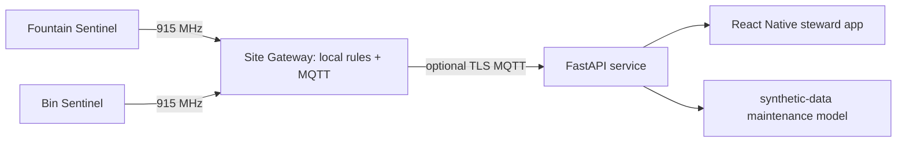

# Architecture

ParkPulse helps municipal and volunteer park stewards discover broken drinking fountains and overflowing waste bins before visitors report them. Existing systems generally require staff walk-throughs; this system correlates direct fixture telemetry with anonymous, coarse use counts and routes maintenance evidence without identifying visitors. It does not assess water potability or dispatch emergency services.

## Nodes and data flow

Three low-voltage nodes: battery-powered Fountain Sentinel (ESP32-C6, pulse/flow + leak switch), solar Bin Sentinel (ESP32-C6, distance + load), and mains-free Site Gateway (Raspberry Pi Zero 2 W with SX1262 concentrator, local MQTT/API and display). Sub-GHz point-to-point 915 MHz (US variant only) transports signed application frames; regional radio variant and legal limits must be selected before deployment. Gateway buffers locally and synchronizes only when configured. No cameras, microphones, faces, or device identifiers tied to visitors.

Essential functions remain local. Gateway loss means nodes buffer bounded samples (256 records); on overflow oldest telemetry is discarded and an LED indicates fault. WAN/broker loss queues 7 days on gateway disk. Sensor faults are reported as unknown, never interpreted as service failure.

## Power / safety

Sentinels use protected 1-cell LiFePO4 1500 mAh packs with solar charge controller; design target average current 1.2 mA yields 1500/1.2/24 = 52 days before solar contribution (capacity derating and cold weather reduce this). Validate measured current before claiming runtime. Nodes only sense; no water, electrical, or public infrastructure actuation. Install outside potable-water wetted paths; enclosure/cable work needs facilities approval.

## Privacy and security

Counts are quantized to 15-minute bins and never represent individuals. MQTT requires per-device credentials and TLS in deployment; examples contain no credentials. Prototype frame CRC detects corruption, not tampering; radio must be treated as untrusted and authenticated encryption is a deployment requirement before public use. Retain raw telemetry 30 days by default; stewards can delete site data.

## Known gaps

Pin/net assignments are conceptual reference specifications, not verified KiCad capture or PCB layouts. Firmware targets are host-testable HAL examples, not vendor SDK projects. No radio range, enclosure ingress, water-quality, or field performance has been validated. ML is a synthetic demonstration and must not drive maintenance decisions without labeled field data and human review.
